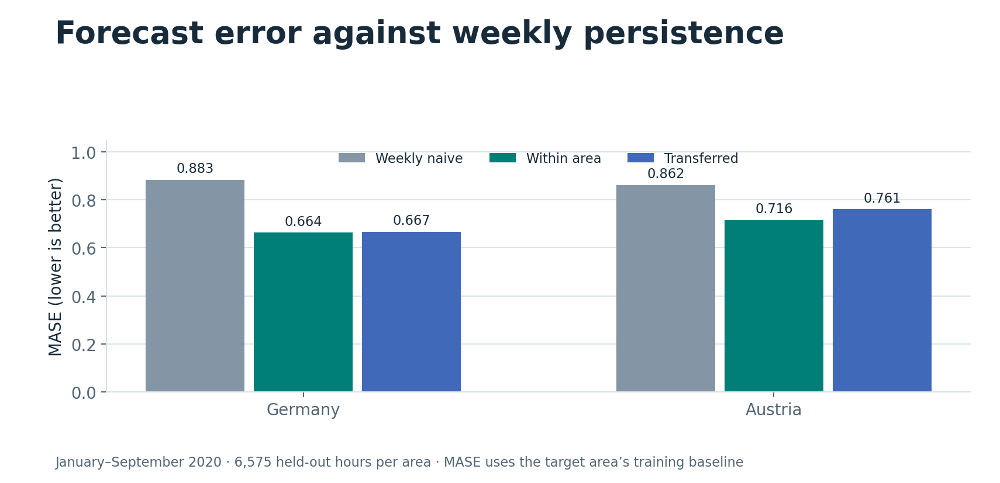
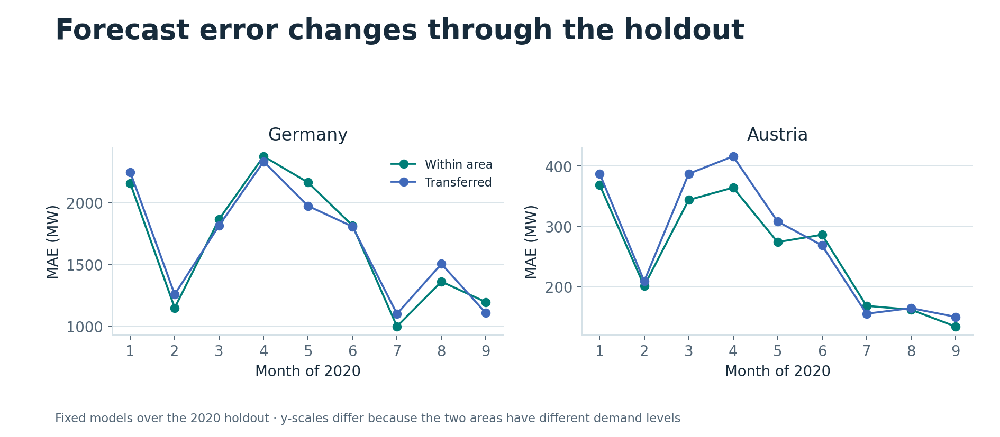
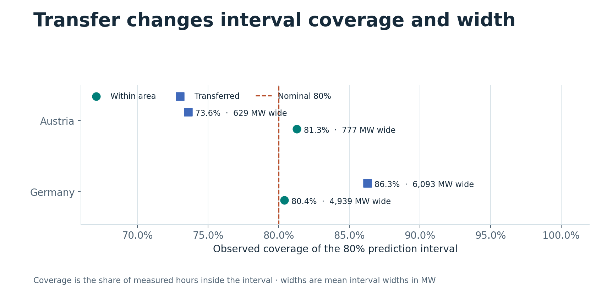

# Grid Load Transfer Benchmark

Forecast the next local delivery day's hourly electricity load in Germany and Austria. Test an area's own model, a model fitted in the other area, and a weekly seasonal baseline on the same retrospective holdout.

## Results

The benchmark scored **6,575 hours per area** from January to September 2020. Histogram boosting with 15 leaves won rolling validation in both areas.

| Target | Forecast | MAE (MW) | MASE | 80% interval coverage |
| --- | --- | ---: | ---: | ---: |
| Germany | Weekly naive | 2,226.65 | 0.883 | — |
| Germany | Within area | 1,674.21 | 0.664 | 80.4% |
| Germany | Transferred from Austria | 1,680.96 | 0.667 | 86.3% |
| Austria | Weekly naive | 307.22 | 0.862 | — |
| Austria | Within area | 255.36 | 0.716 | 81.3% |
| Austria | Transferred from Germany | 271.37 | 0.761 | 73.6% |

The German transfer into Austria improved on weekly persistence in point error and had narrower intervals with lower coverage than the Austrian model. The report includes interval widths, pinball scores, high-load and daylight-saving diagnostics and feature-group ablations. [Measured metrics](reports/holdout-metrics.json)

## Visual Results Gallery



All models use identical held-out hours in each target country.



Monthly summaries show where transfer and local-model errors diverge.



Transfer into Austria lowers coverage to 73.6% and narrows the interval. The nominal target is 80%.

Recreate the gallery from the reports or run outputs listed below.

```sh
python -m pip install -r requirements-visuals.txt
python plot_results.py
```

## Method


Forecast origin is noon local time on the day before delivery. Lags use 48, 72, 168, 336, 504 and 672 elapsed hours in UTC. Normalize the demand target and lagged features using the median of the 1–4 week lags for that hour. Local hour/day-of-week features preserve weekday effects across zone offsets. Calendar-day lengths are computed in UTC from two local midnights. The model can use recent measured target-area load at issuance during transfer.

Three 2019 folds select models by mean MASE. For each fold, fit only labels observed before the first validation forecast issuance. Calibrate 80% residual bands in relative load units on the validation predictions. Freeze the configuration and refit through the last measured hour before the first 2020 issuance. At test time, all candidates share the same eligible timestamps. MASE uses the mean error of lag 168 on the target area's eligible fitting window. Feature-group ablations refit the selected within-area model after removing one group and report the change in test MAE. The normalization scale remains fixed across ablations.

## Reproduction

Python 3.11–3.13. The independent virtual environment uses pinned binary dependencies.

```powershell
python -m venv .venv
./.venv/Scripts/python.exe -m pip install --only-binary=:all: -r requirements.txt
./.venv/Scripts/python.exe grid_forecast.py fetch --csv data/raw/time_series_60min_singleindex.csv
./.venv/Scripts/python.exe grid_forecast.py benchmark --csv data/raw/time_series_60min_singleindex.csv --out runs/holdout --threads 2
./.venv/Scripts/python.exe -m unittest discover -s tests -v
```

On Unix, use `.venv/bin/python`. Open `runs/holdout/forecast.html` for the comparison. `metrics.json` records coverage and errors; `predictions.csv` contains local-only hourly outcomes. [Source variables and hashes](data/README.md)

## Limitations

This study uses the archived hourly load as available after publication. The origin rule controls clock time. Revisions and recording delay could change which values actually existed at noon. None of the runs includes operational weather forecasts or holiday labels. The model and interval calibration reuse rolling validation; the held-out period estimates performance under temporal dependence. Nominal interval coverage is an empirical comparison. The study covers two areas and a historically unusual period.

## License and references

MIT for project code. [OPSD snapshot](https://data.open-power-system-data.org/time_series/2020-10-06) · [OPSD project paper](https://arxiv.org/abs/1812.10405)
